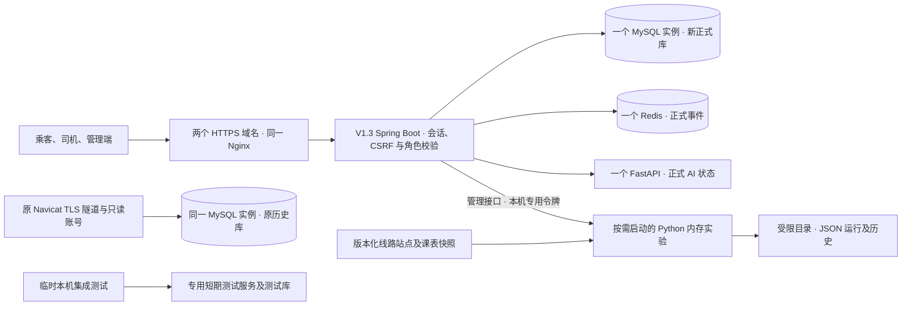

# ShuttleFlow V1.3 单栈升级与算法实验验收

基线：`bfca4ae`；开发分支：`codex/v1.3-isolated-algorithm-lab`。截至 2026-11-24，**仅本地验收，VPS 正式域名仍按原路由，旧系统未下线。** 本报告取代[上次切换报告](V1.3正式站升级验收报告.md)中“两套完整后端”的目标方案，不替代其现场核查和备份记录。

## 架构及算法边界



- 正式站保留原 Java CUSUM、ETA、车辆评分和现有 FastAPI 融合/预测服务；原身份、限流、CSRF 和 WebSocket 心跳代码未改动。正式配置关闭旧仿真 Controller、旧模拟 CUSUM 触发口和高级页的模拟 Kalman 写入。真实算法服务和 Java FusionService 不变。
- 新引擎只读仓库初始化 SQL 中线路、站点、区间距离与耗时、课表的受控种子数据，无需连接 MySQL；部署前若现场基础数据不同，需核对并审查新快照版本。引擎不接收业务密码、DB/Redis 客户端或正式 AI 令牌。任务和车辆只是内存对象；管理员操作以现有 CSRF 防护及角色校验转发，不把实验令牌传给浏览器；工作台轮询仅管理员可见的实验状态，不在业务 WebSocket/Redis 广播实验事件。
- 三策略共享事件队列、客流生成、发车基础计划和上下客规则。固定班次不追加任务；简单阈值用现有 8/15 规则；智能使用 8/15/25、按分钟的 Java CUSUM 规则、课表预置和现有车辆评分。对照核验生产算法的固定基线、方向内 ETA（包含 600 秒默认值）、归一化及成本权重；FastAPI 演示 CUSUM 的自适应基线未拿来代替生产规则。各策略只比较同一客流摘要和配置。
- 车辆和服务是离散事件模型：加入了可达性约束，按线路逐站行驶，待发车辆可提前出车，不瞬移。触发按级别跃迁去抖，课表同日期/场次预置去重，接受、拒绝和任务完成由模型管理；不声称 Excel/JSON 结果等同于线上事务与调度任务。卡尔曼、多车建议、共享站全局调度未计入本轮策略比较；旧真实 HTTP 仿真仅供临时集成测试，不能从正式站触发。

## 修改文件

| 文件 | 说明 |
| --- | --- |
| `simulation/experiment.py`、`experiment_server.py` | 独立事件引擎、回环实验服务、文件历史与执行上限。 |
| `simulation/operation_config.py`、`operation.py`、`runtime.py` | 复用配置；保留旧 HTTP 测试引擎；增加本机独立端口的 `--lab` 启动方式。 |
| `ExperimentController.java`、`AdminController.java` | 实验代理、管理员控制权限、禁止正式站上传模拟观测；禁止同时启用两种仿真。 |
| 前后端两份 `operation.js` | 保留六个标签页，正式模式不提供测试司机账号，不触发旧的高级模拟接口。 |
| `deploy/.env.production.example`、`deploy/v13/lab/` | 分离运行配置、systemd 与双域名 Nginx 模板。 |
| `simulation/tests/test_experiment.py`、`simulation/acceptance_experiment.py`、`simulation/browser-tests/experiment.mjs` | 规则数值回归、HTTP 隔离验证及无头浏览器验收。 |

## 本地实测

- Java 17 项、Python 10 项全部通过。独立 MySQL、真实 Java HTTP、Redis、FastAPI 和内存实验一起运行：在实验过程中使用真实注册会话签到，实验暂停、继续、停止、重置后，候车人数、车辆列表、FastAPI CUSUM 状态、Redis 事件流条目逐项相等，仍可取消原候车请求。匿名、乘客不能操作实验；旧时钟、模拟 CUSUM、模拟 Kalman 写入均拒绝。
- 新会话无头 Chromium：管理员登录，六个工作台标签可用；乘客注册、重复提交保护、重复手机号提示、登录、退出与游客访问通过。本地直连 WebSocket 保持 65 秒；未经过公网反代。
- 同一实验服务、相同种子、100 名虚拟乘客、4 辆车，三次运行的客流摘要一致。结果仅适用于这一条模拟客流序列。

| 策略 | 上车 / 取消 | 平均候车（秒，只统计已上车） | P95（秒） | 峰值排队 | 完成任务 |
| --- | --- | ---: | ---: | ---: | ---: |
| 固定班次 | 65 / 35 | 649.9 | 882 | 100 | 0 |
| 简单阈值 | 65 / 35 | 649.9 | 882 | 100 | 1 |
| 智能 | 65 / 35 | 417.8 | 402 | 100 | 4 |

本地运行文件及截图保存在 `/private/tmp/shuttle-isolated-lab-20261124/`；不提交测试凭据或过程数据。没有据此宣称真实校车的候车改善率。

## VPS 切换顺序与回滚

1. 本次只读复查：V1.2、V1.3 Java 服务仍 active，Fail2ban 仍 failed，本次 SSH 连接成功，sudo 需要终端交互。在现有 Tabby 执行下面的脚本，验证双库备份、隔离恢复和 SHA-256。按最新要求，本次跳过 Fail2ban，不修改现有 jail。未收到结果前不视为通过。

   ```bash
   sudo bash /home/shuttle/vps-deploy/preflight-production-cutover-backup.sh "$SSH_CONNECTION" --backup-only
   ```

2. 比对两个旧库，按注册和实际使用等可核验依据列出需要保留的业务记录及依赖。若无法可靠分类，在 V1.3 的同一 MySQL 实例（3308）上新建正式库，只向已核实为空的新库导入基础种子；用户确认迁移清单、外键与关联核验后再导入。保留两个旧库和备份。原 V1.3 库继续由 `navicat_reader` 按原授权查看，不自动授予生产库权限，不改变 TLS 和隧道。
3. 将保留的 Java 服务连接新正式库，不使用旧仿真环境的 env；验收 `SHUTTLE_OPERATION_ENABLED=false`、`SHUTTLE_SIMULATION_ENABLED=false`、周期 CUSUM 开启。仅 Java 与实验 unit 共享实验令牌，单独的 `/etc/shuttle-v13/experiment.env`（0600）不得包含业务凭据；新 unit 与正式 Java target 不绑定，可按需启动。发布准备必须带 `simulation/` 和初始化 SQL，启动后检查受限存储权限和资源。
4. 使用两域名各自的现有证书与 ACME webroot 渲染 Nginx 模板，先走回环/独立验收入口。确认两个域名配置精确允许的 HTTPS Origin，使用 Secure、HttpOnly、host-only Cookie，代理真实来源 IP，旧写入端点不对公网开放。通过 `nginx -t` 后才加载切换。验证 HTTPS/WSS 超过 60 秒、管理员与司机权限、真实三端业务闭环、Navicat TLS、备份和监控；再停旧版本专有单元，不共享的历史库文件原地保留。
5. 若验收失败，保留原域名配置及运行版本。若切换后需回退，先阻止新库继续写入，备份并保留切换后新增记录，确认数据处理方案后才恢复原域名、应用路径和旧服务；不要覆盖新库。实验异常可单独停 `shuttle-experiment.service`，不停止正式服务。若删除实验 unit，保留需要的历史 JSON。

**尚未现场执行：** 备份恢复、历史记录分类与迁移授权、切换与公网验收、Navicat TLS 实连、旧单元停止。Fail2ban 按用户指示跳过，保持现状。当前方案不承诺两域名已在新架构运行。
