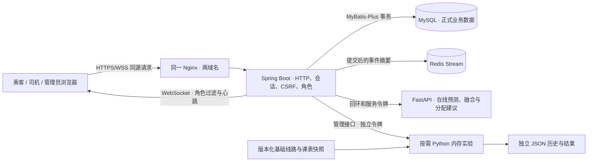
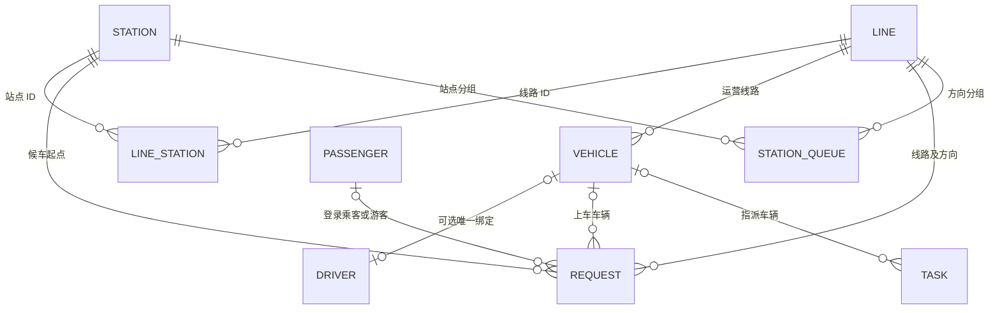

# ShuttleFlow V1.3.1 系统与数据库设计

本文以部署代码 `5540681` 为准。原组内的[概念设计](https://github.com/Asheeeng/shuttleflow/blob/50b740468322eb447e411f70baf3c40e6c20bab2/docs/design-doc.md)保留在中期标签，不能当成实际建表清单。

## 系统架构



- Java 执行业务与状态流转：签到和取消写请求，司机到站并先下后上，`FusionService` 更新队列，`DispatchService` 依据候车阈值和课表创建任务，`SurgeDetectionService` 每分钟依据新增签到计算 CUSUM，`TaskService` 按方向与运行状态筛车、按成本升序派车及处理拒单。Redis 事件摘要不参与事务提交，WebSocket 从 Java 推送状态更新，两者不是同一个队列。
- 同账号失败限制与按 IP 的登录、注册独立窗口是后端行为；业务会话为 host-only Secure/HttpOnly Cookie，两个域名各自建立会话；写操作仍校验 CSRF。
- 实验工作台用 Java `ExperimentController` 管理实验进程，由内存事件引擎生成模拟数据，不改正式时间、账号、车辆和队列。旧 `OperationController` 只在临时 HTTP 集成测试启用。实验结果不发正式 WebSocket，也不写正式 Redis。两套策略实现的边界见 [算法实验验收](deploy/V1.3单栈升级与算法实验验收.md)。

## 数据库关系和约束



图中是业务上的逻辑关联，仓库的 [初始化 DDL](../backend/src/main/resources/sql/init.sql) 没有声明物理 `FOREIGN KEY`。实际库从 V1.2 副本迁移，已有记录原样保留；V1.3 迁移只添加任务方向、索引和行程关联字段，旧任务方向缺失不能擅自猜测（迁移允许 NULL，新建库的任务方向是 NOT NULL）。

| 表 | 主键与关键约束 |
| --- | --- |
| `line`、`station`、`line_station` | 各有 `id` 主键；关联表唯一键 `(line_id,direction,seq)`，`travel_sec` 为本站到下一站秒数。 |
| `driver`、`admin`、`passenger`、`vehicle` | `id` 主键；司机手机号和绑定车辆唯一，管理员用户名唯一，乘客手机号唯一，车牌唯一；核载量大于 0、载客在 0 与核载之间。 |
| `request` | `id` 主键；活动键唯一，按账户或游客会话去重；方向和起点是当前请求所需，目的站、上车车辆和行程字段可以为空。 |
| `station_queue` | `id` 主键；站点、线路、方向唯一，原子更新候车值。 |
| `task`、`event` | `id` 主键；`task_no` 和非空 `dispatch_key` 唯一，任务有方向和状态校验；`event` 记录观测、操作和行程信息，不依赖 Redis 存档。 |
| `alert`、`course_schedule`、`stats` | `id` 主键，分别记录告警、课表先验和统计快照。 |

各字段保持原子，站序与车、站、线路主体分开。讨论 2NF/3NF 时应检查业务候选键，不能只看自增 ID；队列快照、事件载客量和统计值是有意冗余，不等同于候车请求总数。正式只有一个 MySQL 实例：新正式库是应用读写目标，旧仿真库单独保留，只读工具不使用应用服务账号。实验进程无 MySQL 连接。

关键查询的等价形式：

```sql
SELECT s.name, ls.seq, ls.travel_sec
FROM line_station AS ls JOIN station AS s ON s.id = ls.station_id
WHERE ls.line_id = ? AND ls.direction = ?
ORDER BY ls.seq;
```

实际 `CommonController` 对站序和站点分别查询，以上 JOIN 用于答辩解释索引，不冒充 Mapper 的 SQL。候车人数是 `station_queue` 当前快照，必要时可比对同站线方向且 `status='waiting'` 的 `request`；乘客取消使用带状态条件的更新，仅真正成功时扣减队列。

## 部署状态与研究边界

正式配置、备份与回滚见 [V1.3.1 正式部署验收报告](deploy/V1.3.1正式部署验收报告.md)。当前实验比较固定班次、阈值和智能规则；未完成真实校园客流采样、真实改善率或多线路全局最优，OR-Tools 多车建议不直接生成业务调度任务。
